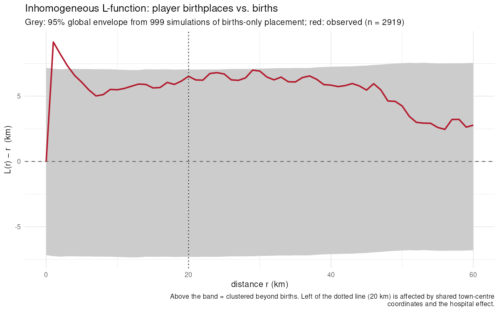
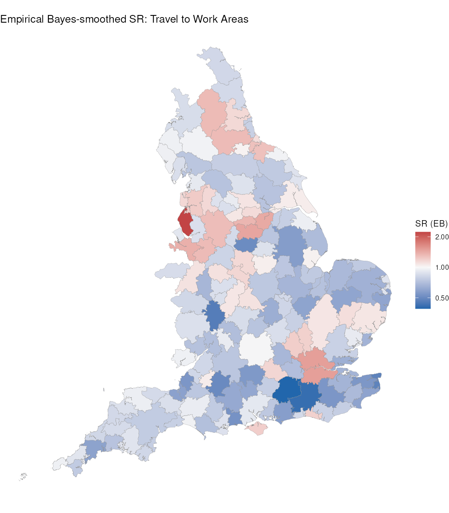
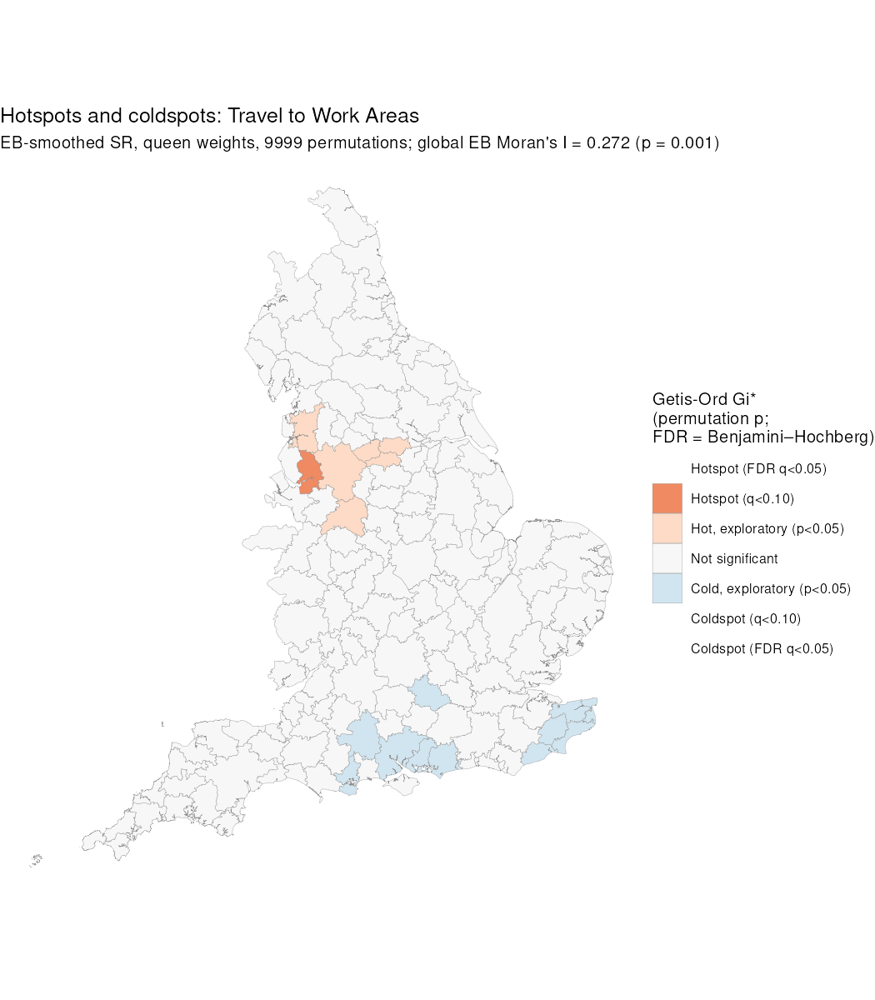
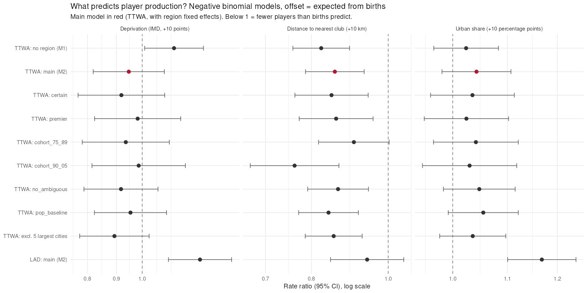
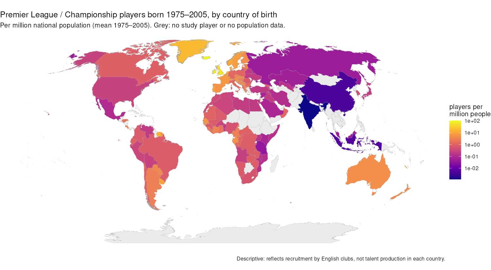

# Where Do England's Premier League and Championship Footballers Come From?

**Detecting birthplace hotspots across England beyond what births predict, and their social and spatial correlates**

**Author:** Dennis Wambua
**Date:** November 2026
**Version:** 1.0 (final report)
**Repository:** `football-talent-hotspots` · **Dashboard:** `app/` (run locally at http://localhost:3838; shinyapps.io deployment pending)
**Detailed step reports:** [Step 2](step2_report.md) · [Step 3](step3_report.md) · [Step 4](step4_report.md) · [Step 5](step5_report.md) · [Step 6](step6_report.md) · [Step 7](step7_report.md)

---

## Summary

This study asks whether England's professional footballers come from particular places **more often than the number of boys born there would predict**, where those places are, and why. It covers **6,581 men born 1975–2005 who made at least one league appearance in the Premier League or the second tier** between 1992/93 and 2025/26. The spatial analysis uses the **3,081 English-born** players (3,017 with a usable birthplace), compared with **9.5 million male births** across 155 Travel to Work Areas.

**Main findings:**

1. **There is a strong north-west versus south/south-east gradient.** A boy born in **London** or the **North West** was about **2.4 times** as likely to reach the top two divisions as one born in the **South West** (players per 10,000 births: 4.56 and 4.29 vs. 1.87). Seven of nine regions differ significantly from the national rate.
2. **Areas cluster, but as a broad belt rather than sharp hotspots.** Neighbouring areas have similar production (EB Moran's I = 0.27, p = 0.001). The strongest cluster is the **Merseyside–Lancashire–Greater Manchester belt**: Liverpool produces 2.2× its expected number. The weakest areas are the **South coast, Kent and parts of the rural South**. After strict multiple-testing correction, no single area is individually significant, so the evidence is for the gradient, not for named hotspots.
3. **Being near a professional club matters.** Each extra **10 km** to the nearest league club at age 12 means **about 14% fewer players** than births predict (rate ratio 0.86, 95% CI 0.79–0.93). This holds in every robustness check and is **stronger for players born since 1990** (0.76).
4. **Being near an elite academy doesn't.** For players born 1996–2005, distance to the nearest **Category 1 academy** has no effect (rate ratio 1.00, p = 0.93), while distance to *any* club does (0.74).
5. **Deprivation and urbanisation don't explain the pattern.** Deprived areas seem to produce more players only because they are mostly in the North; with region taken into account, the effect disappears.
6. **About half of the players were born outside England.** Ireland, Scotland, Wales and Iceland supply the most per head. The number of Scottish players fell sharply between birth cohorts.

---

## 1. Introduction

English football invests heavily in finding young talent, yet it isn't clear whether top players come from across the country in proportion to population or from particular places. Earlier research on the **birthplace effect** (Côté et al., 2006; MacDonald et al., 2009) showed that community size matters in several sports, but it used broad city-size categories rather than spatial statistics. This study applies methods from **spatial epidemiology** (disease mapping) to the birthplaces of English league footballers.

### Research questions

| | Question | Answer (short) |
|---|---|---|
| **RQ1** | Are birthplaces more clustered than births alone would predict? | **Yes**: strongly at the regional scale, modestly at the local scale |
| **RQ2** | Where are the significant hotspots and coldspots? | A **north-west belt** (high) and a **south / south-east coast** zone (low); no single area survives strict correction |
| **RQ3** | Are hotspots linked to deprivation, urbanisation or proximity to clubs and academies? | **Club proximity: yes.** Deprivation (once region is included), urbanisation and academy proximity: no |
| **RQ4** | Which countries supply foreign-born players, and how has this changed? | Ireland, the UK nations and Western Europe; Scottish supply fell sharply |

---

## 2. Data

| Data | Source | Notes |
|---|---|---|
| Players, clubs, birthplaces | **Wikidata** (12,620 players fetched) | Memberships with dates and their precision |
| League appearances | **English Wikipedia** infoboxes | Used to confirm that a player actually played (validation, §4.1) |
| Club division by season, 1985/86–2025/26 | **engsoccerdata** + Wikipedia league tables | 0 mismatches across 32 overlapping season-tables |
| Male births 1975–2005 by local authority | **ONS** mid-year estimates (Nomis), boys aged under 1 | Local authority births on Nomis start only in 2013 |
| Boundaries: LAD 2021, LSOA 2021, TTWA 2011 | **ONS** Open Geography Portal | |
| Deprivation | **English Indices of Deprivation 2025** (MHCLG) | LSOA level |
| Urbanisation | **ONS Rural-Urban Classification 2021** | LSOA level |
| Club grounds by season | Wikidata + 6 documented ground-share fixes | |
| Category 1 academies, 2012/13–2021/22 | Wikipedia U18 national league tables (League 1 = Category 1) | 28 clubs |
| National populations | World Bank WDI; ONS | For RQ4 |

All sources are free. ONS and MHCLG data are used under the Open Government Licence v3.0.

---

## 3. Methods

### 3.1 Study population
- Men, born 1 January 1975 – 31 December 2005.
- **At least one league appearance** for a club in a season when it was in the Premier League or second tier, 1992/93–2025/26:
  - **certain** evidence: the spell was entirely in top-two-division seasons (4,977 players)
  - **probable** evidence: the club changed division during the spell (1,604 players)
- English-born = birthplace inside England (Natural Earth boundaries).

### 3.2 Expected counts and the Standardised Ratio
For every area *i*:

> **Ei = Σy Birthsi,y × (Playersy ÷ BirthsEngland,y)** and **SRi = Oi ÷ Ei**

SR = 1 means as many players as the area's births predict. **Empirical Bayes smoothing** stabilises SR in areas with few births.

### 3.3 Analysis units
**Travel to Work Areas (TTWA, 155)** are the main unit. Local authorities (309) and 20 km hexagons (439) are used for comparison. TTWAs were chosen because of the **hospital effect** (§4.3).

### 3.4 Statistical methods

| Question | Method |
|---|---|
| RQ1 | Players per 10,000 births by region (exact Poisson tests); inhomogeneous L-function with births as background, 999 simulations, 95% global envelope, MAD and DCLF tests; null test |
| RQ2 | Empirical Bayes-smoothed SR; EB Moran's I (999 permutations); Getis-Ord Gi\* and LISA (9,999 permutations) with Benjamini–Hochberg FDR; alternative neighbour definitions and scales |
| RQ3 | Negative binomial regression with offset log E; deprivation, urban share, club distance at age 12, region fixed effects; VIF; residual Moran's I; robust Lagrange Multiplier tests; spatial error and lag models; 9 robustness variants; academy-era sub-model |
| RQ4 | Counts and players per million by country of birth; cohort comparison |

Full explanations: [Statistical Methods guide](../STATISTICAL_METHODS.md).

---

## 4. Data quality and key decisions

### 4.1 A contract isn't an appearance (Step 2)
A 200-player validation against Wikipedia appearance records found that the first, Wikidata-only rule **included 18.6% of players who never played** at that level, mostly academy players under contract. The rule was tightened to require **evidence of a league appearance**. This removed 984 players and added back 415 wrongly excluded ones.

### 4.2 Women's players linked to men's clubs (Step 2)
160 women's players were attached to men's club entries in Wikidata and were excluded with a men-only filter.

### 4.3 The hospital effect (Step 4)
Players' birthplaces are usually the **maternity-hospital town**, while births are counted by the **mother's home area**. At local authority level, hospital towns looked like hotspots and their surrounding districts like coldspots. Oxford's SR was 3.68 while its four neighbouring districts were 0.00–0.60, and Oxfordshire as a whole was 0.92. **Travel to Work Areas** contain both the town and its catchment, so they became the main unit.

### 4.4 "London" birthplaces (Step 4)
98 players are recorded only as "born in London", a point in Westminster. They're counted at TTWA level (the London TTWA covers all 33 boroughs) but not at borough level.

### 4.5 Births baseline (Step 3)
ONS local-authority birth counts start only in 2013, so births are estimated from **boys aged under 1** in ONS mid-year estimates (from 1981; earlier years from 1981 age bands).

### 4.6 Permutation resolution (Step 6)
With 999 permutations, no area could ever pass FDR across 155 areas, because the smallest possible p-value (0.001) is above the required 0.0003. Local tests therefore use 9,999 permutations.

---

## 5. Results

### 5.1 RQ1: Clustering beyond births

| Region | Players per 10,000 male births | SR | p |
|---|---|---|---|
| London | 4.56 | **1.44** | < 0.0001 |
| North West | 4.29 | **1.36** | < 0.0001 |
| North East | 3.69 | 1.17 | 0.04 |
| Yorkshire and The Humber | 3.49 | 1.10 | 0.07 |
| West Midlands | 2.93 | 0.93 | 0.19 |
| East of England | 2.48 | 0.79 | < 0.0001 |
| East Midlands | 2.24 | 0.71 | < 0.0001 |
| South East | 2.13 | 0.67 | < 0.0001 |
| South West | 1.87 | **0.59** | < 0.0001 |

The **inhomogeneous L-function** finds player birthplaces more bunched together than births would produce, consistently by about +6 km at every distance up to 60 km:
- **DCLF test:** p = 0.022 over 0–60 km and p = 0.031 over 20–60 km
- **MAD test:** p = 0.032 and 0.051
- **Null test** (fake births-only players): p ≈ 0.5

### 5.2 RQ2: Where

| Highest smoothed SR | SR | Lowest smoothed SR | SR |
|---|---|---|---|
| Liverpool | **2.23** | Guildford & Aldershot | **0.39** |
| London | 1.49 | Crawley | 0.41 |
| Sheffield | 1.45 | Worcester & Kidderminster | 0.46 |
| Doncaster | 1.42 | Margate & Ramsgate | 0.48 |
| Chester | 1.38 | Trowbridge | 0.50 |
| Barnsley | 1.35 | Chesterfield | 0.51 |

- **Global clustering:** EB Moran's I = **0.27, p = 0.001** at TTWA level, with both neighbour definitions.
- **Local Gi\*:** the strongest cluster is **Warrington & Wigan** (z = 5.15, q = 0.06), surrounded by Liverpool, Manchester and Preston. Seven TTWAs from Merseyside and Lancashire across to South Yorkshire and Stoke are hot, and eleven along the South coast and in Kent are cold, at unadjusted p < 0.05. Under normal-theory tests, five North West / Yorkshire TTWAs pass FDR: Warrington & Wigan, Preston, Liverpool, Barnsley and Manchester.

### 5.3 RQ3: Why

Main model, 155 TTWAs, negative binomial with region effects. Rate ratios with 95% confidence intervals:

| Variable | Rate ratio | 95% CI | p |
|---|---|---|---|
| **Distance to nearest professional club at age 12 (+10 km)** | **0.86** | 0.79–0.93 | **0.0004** |
| Deprivation (+10 IMD points) | 0.95 | 0.82–1.10 | 0.46 |
| Urban share (+10 percentage points) | 1.04 | 0.98–1.11 | 0.18 |

- **Deprivation without region effects:** 1.14 (p = 0.03). It's a proxy for the North.
- **Region effects** (vs. West Midlands): North West and North East **1.39**, Yorkshire 1.17, London 1.10, South East 0.78, South West 0.77. They improve the model (p = 0.002).
- **Spatial dependence:** none left once region is included (residual Moran's I = 0.03, p = 0.26). The spatial error and lag models add nothing and confirm the club-distance effect.

**Robustness** (club distance, rate ratio per 10 km): certain-only 0.85 · Premier League only 0.86 · born 1975–89 0.91 · **born 1990–2005 0.76** · excluding ambiguous players 0.86 · total-population baseline 0.84 · excluding the five largest cities 0.85. At local authority level (0.94, not significant) results are distorted by the hospital effect.

**Academy-era sub-model** (594 players born 1996–2005):

| | Rate ratio per +10 km | p |
|---|---|---|
| Any professional club | **0.74** | 0.0007 |
| Category 1 academy | 1.00 | 0.93 |
| Both together: club / academy | **0.73** / 1.03 | 0.0004 / 0.36 |

### 5.4 RQ4: Foreign-born players

| Born in | 1975–1989 | 1990–2005 | All |
|---|---|---|---|
| England | 45.2% | 49.1% | 46.8% |
| Scotland, Wales, Northern Ireland | 8.1% | 4.6% | 6.7% |
| Outside the UK | 46.5% | 45.9% | 46.3% |

- **Largest suppliers:** France 372, Scotland 233, Ireland 223, Spain 222, Netherlands 161, Brazil 119, Wales 119.
- **Per million people** (≥ 10 players): Iceland 106, England 64, Ireland 62, Scotland 46, Wales 41, Denmark 16.
- **Change between cohorts:** Scotland 179 → 54, Argentina 60 → 30, Australia 55 → 24; Germany 39 → 60, Belgium 33 → 50.

---

## 6. Discussion

**A north-west footballing belt.** The clearest finding is geographic. Merseyside, Lancashire, Greater Manchester, South Yorkshire and the North East produce far more top-two-division players per birth than the South and East. This fits the historic concentration of professional clubs and football culture in the industrial North. The pattern isn't explained by deprivation or urbanisation. It operates at the scale of **regions and city-regions**, not individual towns, which is why region effects remove the spatial clustering from the models and why no single area survives strict correction.

**Local opportunity matters more than elite infrastructure.** Within regions, children who grew up closer to *any* professional club were more likely to reach the top two divisions, and the effect has grown for cohorts born since 1990. Distance to the elite **Category 1** academies created by EPPP had no effect. One reading is that the route into professional football starts locally, at the nearest club's academy or development centre, and talented players move to elite academies later. Proximity to a club may also reflect scouting coverage: scouts see more of the children who live near them.

**London** stands out in the South as a strong producer (SR 1.44). Its large and diverse population, dense club network (more than a dozen league clubs) and strong grassroots football all plausibly contribute.

**Foreign-born players.** Half of the players were born outside England, mostly in Western Europe, Ireland and the other UK nations. The sharp fall in Scottish-born players between cohorts is notable and may reflect changes in both Scottish football and English clubs' recruitment.

---

## 7. Limitations

1. **Association, not causation.** Club locations reflect historic population and industry; proximity may stand in for unmeasured local football culture.
2. **Community-edited data.** Wikidata and Wikipedia are incomplete and sometimes wrong. The validation used Wikipedia, which isn't fully independent of Wikidata.
3. **Birthplace ≠ upbringing.** Players are placed where they were born, often a hospital town. TTWAs reduce but don't remove this.
4. **The births baseline is a proxy** (boys aged under 1 at mid-year).
5. **Deprivation is measured in 2025**, not when the players grew up.
6. **Weak evidence for individual hotspots.** After FDR correction no TTWA is individually significant; conclusions rest on the overall pattern.
7. **24% of players have "probable" evidence**, so the Premier League flag is uncertain for many of them.
8. **The academy location is the club stadium**, not the training ground. The academy list relies on Wikipedia and two imputed seasons.
9. **The youngest cohort (born 2000–05) is incomplete**, because many of these players are still early in their careers.
10. **Ecological fallacy.** Results describe areas, not individuals, and shouldn't be used to stereotype places or communities.

---

## 8. Changes from the original proposal (v2.1)

| Proposal | What was done | Reason |
|---|---|---|
| Eligibility from Wikidata memberships | League-appearance evidence (Wikipedia infobox) required | 18.6% false inclusions found in validation |
| ONS live births as baseline | Boys aged under 1 from ONS mid-year estimates | Local authority births available only from 2013 |
| Local authorities as main unit | **Travel to Work Areas** | Hospital effect |
| Current LAD boundaries | 2021 boundaries (309) | Only boundaries with population data back to 1981 |
| IMD 2019 | IMD **2025** | Newest release, same neighbourhoods |
| 999 permutations for local tests | 9,999 | 999 can't pass FDR with 155 areas |
| Published Category 1 list | U18 national league structure (Wikipedia) | No official historical list exists |
| Manual squad-list validation | Automated Wikipedia validation | Manual check not done |
| 10 km hexagons, MSOA, BYM2 | Not used | Too sparse / optional / not needed |
| UN WPP populations | World Bank WDI (from UN WPP) | Simpler access |

---

## 9. Reproducibility

The whole analysis runs in Docker (R 4.5.1, Python 3.12, PostGIS 16). Package versions are pinned (`renv.lock`, `requirements.txt`), raw downloads are dated snapshots, and every simulation uses a fixed seed. The step-by-step commands are in the [README](../../README.md); variables are described in the [Data Dictionary](../DATA_DICTIONARY.md). Tests: 34 Python tests (season rule, counts), R environment tests, and dashboard tests.

---

## References

- Anselin, L. (1988). *Spatial econometrics: Methods and models*. Kluwer Academic.
- Anselin, L. (1995). Local indicators of spatial association—LISA. *Geographical Analysis, 27*(2), 93–115.
- Assunção, R. M., & Reis, E. A. (1999). A new proposal to adjust Moran's I for population density. *Statistics in Medicine, 18*(16), 2147–2162.
- Baddeley, A., Møller, J., & Waagepetersen, R. (2000). Non- and semi-parametric estimation of interaction in inhomogeneous point patterns. *Statistica Neerlandica, 54*(3), 329–350.
- Baddeley, A., Rubak, E., & Turner, R. (2015). *Spatial Point Patterns: Methodology and Applications with R*. CRC Press.
- Benjamini, Y., & Hochberg, Y. (1995). Controlling the false discovery rate. *Journal of the Royal Statistical Society: Series B, 57*(1), 289–300.
- Côté, J., MacDonald, D. J., Baker, J., & Abernethy, B. (2006). When "where" is more important than "when": Birthplace and birthdate effects on the achievement of sporting expertise. *Journal of Sports Sciences, 24*(10), 1065–1073.
- Getis, A., & Ord, J. K. (1992). The analysis of spatial association by use of distance statistics. *Geographical Analysis, 24*(3), 189–206.
- MacDonald, D. J., Cheung, M., Côté, J., & Abernethy, B. (2009). Place but not date of birth influences the development and emergence of athletic talent in American football. *Journal of Applied Sport Psychology, 21*(1), 80–90.
- Marshall, R. J. (1991). Mapping disease and mortality rates using empirical Bayes estimators. *Journal of the Royal Statistical Society: Series C, 40*(2), 283–294.
- Ministry of Housing, Communities & Local Government (2025). *English indices of deprivation 2025*.
- Venables, W. N., & Ripley, B. D. (2002). *Modern Applied Statistics with S* (4th ed.). Springer.
- Vrandečić, D., & Krötzsch, M. (2014). Wikidata: A free collaborative knowledgebase. *Communications of the ACM, 57*(10), 78–85.
