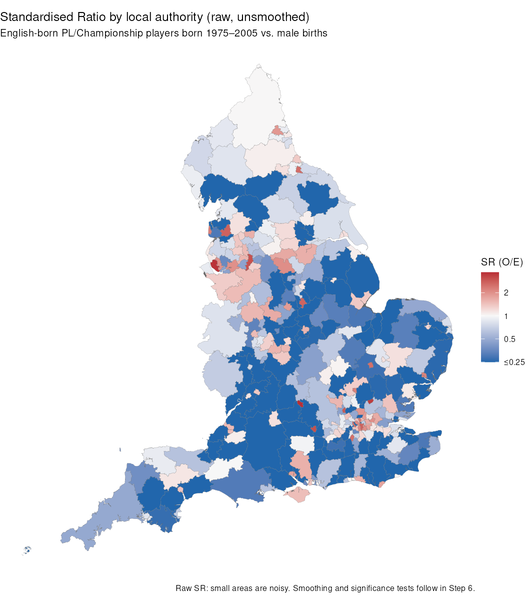
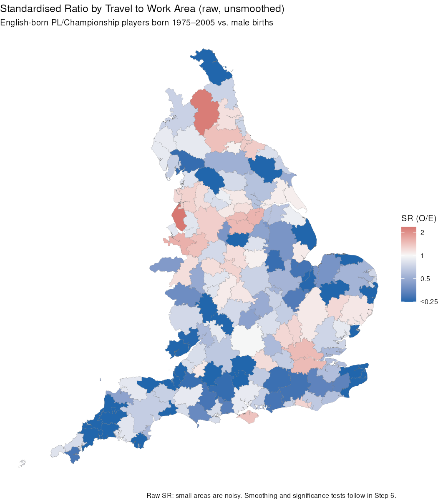

# Step 4 Report: Analysis Units and Expected Counts

**Project:** football-talent-hotspots, i.e. where England's Premier League and Championship footballers come from
**Author:** Dennis Wambua
**Step:** 4 of 8 (Milestone M2: analysis-ready database)
**Completed:** 18 November 2026
**Related:** [Work Plan](../WORKPLAN.md) · [Step 2 Report](step2_report.md) · [Step 3 Report](step3_report.md) · [Statistical Methods](../STATISTICAL_METHODS.md)

---

## 1. Purpose

Step 4 joins the **players** (Step 2) to the **areas** (Step 3) and answers the first quantitative question for every area of England:

> How many players were born here (**O**), how many would we expect from the number of boys born here (**E**), and what is the ratio (**SR = O / E**)?

These numbers are the input for every analysis that follows: clustering (Step 5), hotspots (Step 6) and explanatory models (Step 7).

---

## 2. Final result

### 2.1 Analysis units

| Unit | Number in England | Role | Median expected players | Units with 0 players |
|---|---|---|---|---|
| **Travel to Work Areas 2011 (TTWA)** | **155** | **Main unit** (decided in this step) | 9.4 | 14 (9%) |
| Local authority districts 2021 | 309 | Comparison | 6.7 | 45 (15%) |
| Hexagons, 20 km (346 km² each) | 439 | Boundary-free robustness check | 2.6 | 215 (49%) |
| Hexagons, 10 km (87 km² each) | 1,551 | Exploratory only (very sparse) | 0.55 | 1,202 (78%) |

### 2.2 Players in the analysis

| Group | Players | Used at |
|---|---|---|
| English-born, town-level birthplace | 2,919 | All units |
| English-born, birthplace "London" only | 98 | TTWA only (see §4.1) |
| **Total placed** | **3,017** | |

### 2.3 Variants computed (for the Step 7 robustness checks)

| Variant | Players | Expected-count baseline | Correlation of TTWA SR with main |
|---|---|---|---|
| `main` (certain + probable evidence) | 3,017 | Male births | — |
| `certain` (certain evidence only) | 1,918 * | Male births | 0.89 |
| `premier` (Premier League subset) | 1,543 * | Male births | 0.84 |
| `cohort_75_89` (born 1975–1989) | 1,664 * | Male births | 0.89 |
| `cohort_90_05` (born 1990–2005) | 1,255 * | Male births | 0.78 |
| `no_ambiguous` (excl. season-ambiguous) | 2,756 * | Male births | — |
| `pop_baseline` (main players) | 3,017 | Total population | **0.99** |

\* Counts at local authority level (town-level birthplaces). TTWA counts are slightly higher because they include the London-only birthplaces.

The variants correlate strongly with the main result (0.78–0.99). The pattern doesn't depend much on which players are included or on which baseline is used. The weakest agreement is for the younger cohort, which is the smallest group.

### 2.4 First look: SR by TTWA (raw, not yet smoothed or tested)

| Above expected | O | E | SR | | Below expected | O | E | SR |
|---|---|---|---|---|---|---|---|---|
| Liverpool | 156 | 66.2 | **2.35** | | Margate & Ramsgate | 1 | 9.4 | **0.11** |
| Chester | 18 | 11.2 | 1.61 | | Weston-super-Mare | 1 | 7.4 | 0.13 |
| Doncaster | 30 | 19.1 | 1.57 | | Newbury | 1 | 7.2 | 0.14 |
| Sheffield | 73 | 48.2 | 1.51 | | St Austell & Newquay | 1 | 6.3 | 0.16 |
| London | 690 | 460.0 | 1.50 | | Thetford & Mildenhall | 1 | 6.1 | 0.16 |
| Barnsley | 23 | 15.3 | 1.50 | | Lowestoft | 1 | 6.1 | 0.16 |
| Durham & Bishop Auckland | 22 | 15.2 | 1.45 | | Clacton | 1 | 5.0 | 0.20 |
| Crewe | 24 | 16.7 | 1.44 | | Canterbury | 2 | 9.2 | 0.22 |
| Middlesbrough & Stockton | 44 | 32.9 | 1.34 | | Trowbridge | 3 | 12.6 | 0.24 |
| Manchester | 217 | 165.0 | 1.31 | | Worcester & Kidderminster | 4 | 16.6 | 0.24 |

(TTWAs with E ≥ 5.)

**Pattern:** above-expected areas cluster in **Merseyside and Cheshire, Greater Manchester, South Yorkshire, the North East and London**. Below-expected areas are mostly in the **rural and coastal South West, South East, Kent and East Anglia**.




⚠️ These are **raw** ratios. Small areas are noisy (40 of 155 TTWAs expect fewer than 5 players), and nothing has been tested yet. Empirical Bayes smoothing, Moran's I and Gi\* in Step 6 decide which differences are real.

### 2.5 Output files

| File | Contents |
|---|---|
| `data/processed/counts_{ttwa,lad21,hex10,hex20}.csv` | Area × variant: O, E, births, SR |
| `data/processed/player_units.csv` | Each player's TTWA, local authority and hexagons |
| `data/processed/ttwa11_england.gpkg`, `hex10_england.gpkg`, `hex20_england.gpkg` | Area polygons (EPSG:27700) |
| `data/processed/ttwa_covariates.csv` | TTWA deprivation, urban share, club distance (for Step 7) |
| PostGIS schema `talent` | `lad21`, `ttwa11`, `hex10`, `hex20`, `players`, `counts_*`, with GiST spatial indexes |
| `docs/reports/figures/step4_sr_*.png` | Maps |

---

## 3. What was done

### 3.1 Hexagon grids
Regular hexagons were laid over England in British National Grid at 10 km and 20 km spacing (`sf::st_make_grid`). Only hexagons containing at least one populated neighbourhood (LSOA centroid) were kept, which drops sea and empty upland.

### 3.2 Births for every unit
- **Local authorities:** births come directly from Step 3.
- **TTWAs and hexagons:** each local authority's births were shared out to its neighbourhoods (LSOAs) in proportion to their population. Each neighbourhood was then assigned to the TTWA and hexagons containing its centre.
- **Check:** the total of 9.54 million births is preserved exactly at every level.

### 3.3 Placing players
Each player's birthplace point was placed in its local authority, TTWA and hexagons (point-in-polygon in British National Grid). One coastal point was snapped to land (≤ 5 km). No players were left unplaced.

### 3.4 Observed, expected, SR
Following the proposal (section 6.4):

> E<sub>i</sub> = Σ<sub>y</sub> Births<sub>i,y</sub> × (Players<sub>y</sub> ÷ Births<sub>England,y</sub>)

*Players<sub>y</sub>* counts only the players placed at that level, so **total observed = total expected** at every level, which the tests check. This was done for 7 variants (§2.3), including a **total-population baseline** for the planned sensitivity analysis.

### 3.5 Database
All units, players and count tables were loaded into **PostGIS** (schema `talent`) with **GiST spatial indexes**, as planned.

### 3.6 Main unit decision
After the problems in §4, **Travel to Work Areas were adopted as the main unit** for Steps 5–7. Local authorities and hexagons are kept for the multi-scale comparison the proposal requires. TTWA versions of the Step 3 variables were computed (`analysis/prepare/03_area_covariates.R`): deprivation, urban share and club distance.

### 3.7 Tests
`tests/test_counts.py` adds 14 tests (34 in the project). They check that:
- observed totals equal expected totals for every level and variant
- births are fully allocated
- there are no negative or missing values
- every player has all units
- "London" birthplaces are used at TTWA level only

---

## 4. Challenges and how they were solved

### 4.1 "London" birthplaces → a false Westminster hotspot
The first run showed **Westminster with SR 11.9** (118 players against 9.9 expected). **98 of those 118** have the birthplace "London", which Wikidata pins to **Charing Cross, in Westminster**. Any player recorded as "born in London" was being put in one borough.

**Fix:** places covering several local authorities are now region-level (`data/manual/multi_lad_places.csv`, currently just London). They're excluded from local authority and hexagon counts, but used at **TTWA level**, because the London TTWA covers all 33 boroughs. Liverpool, Birmingham, Manchester, Sheffield and the other big-city birthplaces each coincide with a single local authority, so they're unaffected.

### 4.2 The hospital effect → local authorities are unreliable
With London fixed, the local authority results still showed a systematic pattern. **Towns with large maternity hospitals were "hotspots" and their surrounding districts were "coldspots":**

| Area | Hospital town | Neighbouring districts | Combined |
|---|---|---|---|
| Oxfordshire | Oxford **3.68** | 0.00 – 0.60 | **0.92** |
| Southampton area | Southampton **1.78** | 0.00 – 0.12 | **0.62** |
| Watford area | Watford **2.87** | 0.00 – 1.55 | **1.16** |
| Bristol area | Bristol **1.49** | 0.00 – 1.07 | **0.82** |

**Why:** Wikipedia and Wikidata record the **place of birth**, usually the town with the maternity unit. Our births baseline counts babies by **the mother's home area**. A baby from a village in South Oxfordshire born at the John Radcliffe Hospital counts as an "Oxford" player but as a South Oxfordshire birth.

**Fix:** added **Travel to Work Areas** (ONS, 2011), functional areas built around where people live and work. Each one normally contains a town (and its hospital) **plus** the surrounding catchment, so the mismatch largely cancels out. At TTWA level the patchwork disappears and a coherent regional pattern appears (§2.4 maps).

The proposal had anticipated this ("hospital effect → local authority and coarser scales"), but its size made it necessary to **change the main unit** rather than treat it only as a robustness check.

### 4.3 Sparse hexagons
At 10 km, **78% of hexagons have no player** and the median expected count is 0.55. That's too sparse for reliable hotspot statistics. 20 km hexagons (median expected 2.6) are usable with smoothing. **Decision:** 10 km hexagons are exploratory only, and 20 km hexagons are the boundary-free robustness check.

### 4.4 Smaller technical issues
- A column-name mismatch (`lad21` vs `lad21cd`) stopped the first run. Fixed.
- PostGIS returned row counts as 64-bit integers, which printed as nonsense (`1.5e-321`). Converted for display. The data itself was correct.

---

## 5. Limitations

1. **TTWAs reduce the hospital effect but don't remove it.** A few hospitals serve parts of neighbouring TTWAs, and players born in a hospital town but raised elsewhere are still counted where they were born.
2. **TTWAs are from 2011.** Commuting areas change slowly, but 2011 boundaries are a compromise for cohorts born 1975–2005.
3. **Births shared to neighbourhoods by 2022 population.** Moving births from local authorities to TTWAs and hexagons uses where people live today, not where they lived decades ago. Where TTWA and local authority boundaries cut across each other, this matters a little.
4. **Big-city birthplaces.** "Liverpool" or "Manchester" may be recorded for players born in neighbouring boroughs. TTWA level absorbs this (Liverpool and Manchester TTWAs include those boroughs), but local authority figures for these cities are inflated.
5. **Small numbers.** 40 of 155 TTWAs expect fewer than 5 players, so their raw SRs are unstable until smoothed (Step 6).
6. **Excluded birthplaces.** 46 English-born players with only "England" and 18 with only a county as birthplace can't be placed and aren't in any count.

---

## 6. Deviations from the proposal (v2.1)

| Proposal | What was done | Reason |
|---|---|---|
| Local authorities as the main unit | **Travel to Work Areas** as the main unit; local authorities and hexagons for comparison | Strong hospital effect at local authority level (§4.2) |
| Units: local authorities, MSOA (optional), 10 & 20 km hexagons | Added TTWAs; MSOA skipped; 10 km hexagons exploratory only | TTWA needed; MSOA optional; 10 km too sparse |
| All town/city birthplaces placed at local authority level | "London" treated as region-level (TTWA only) | Its coordinates are a single central point |
| Population fallback where births are missing | Not needed (no gaps); total-population baseline run as a variant | Births available for all areas and years |

These should go into the proposal's section 6.5 (spatial units) at the next revision.

---

## 7. Implications for the next steps

- **Step 5 (RQ1):**
  - Ripley's K uses individual points, so the hospital effect matters there too. The births intensity surface should be smoothed at a scale wider than hospital catchments (~10–20 km).
  - Use the 2,919 town-level players, since the "London" points can't be used.
  - Download GHS-POP, or use the births already shared to neighbourhoods, for the intensity surface.
- **Step 6 (RQ2):** main analysis on **155 TTWAs**, with Empirical Bayes smoothing, EB Moran's I and Gi\* with FDR. Repeat on local authorities and 20 km hexagons.
- **Step 7 (RQ3):** use `ttwa_covariates.csv`. Urban share and club distance overlap (r = −0.56 at TTWA level), so check variance inflation factors.

---

## 8. How to reproduce

Inside the app container (`docker compose exec app bash`), after Steps 2–3:

```bash
python pipeline/areas/11_ons_boundaries.py     # includes TTWA boundaries
Rscript analysis/prepare/03_area_covariates.R         # LSOA -> TTWA, TTWA covariates
Rscript analysis/prepare/04_expected_counts.R         # units, O/E/SR, PostGIS, maps (~3 min)
pytest tests/                          # 34 tests
```

---

## Sources

- Office for National Statistics, Open Geography Portal: Travel to Work Areas (December 2011) boundaries, Local Authority Districts (December 2021), LSOA 2021. Open Government Licence v3.0.
- Births, players and covariates as in the Step 2 and Step 3 reports.
