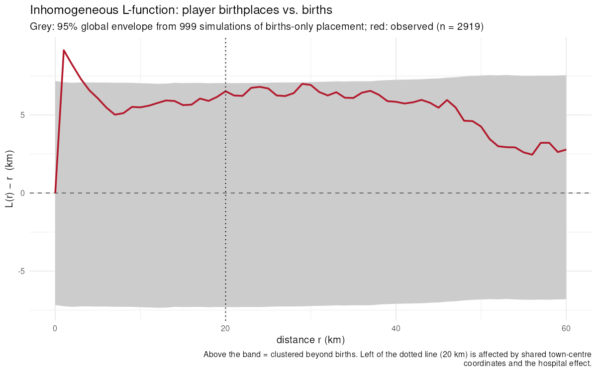
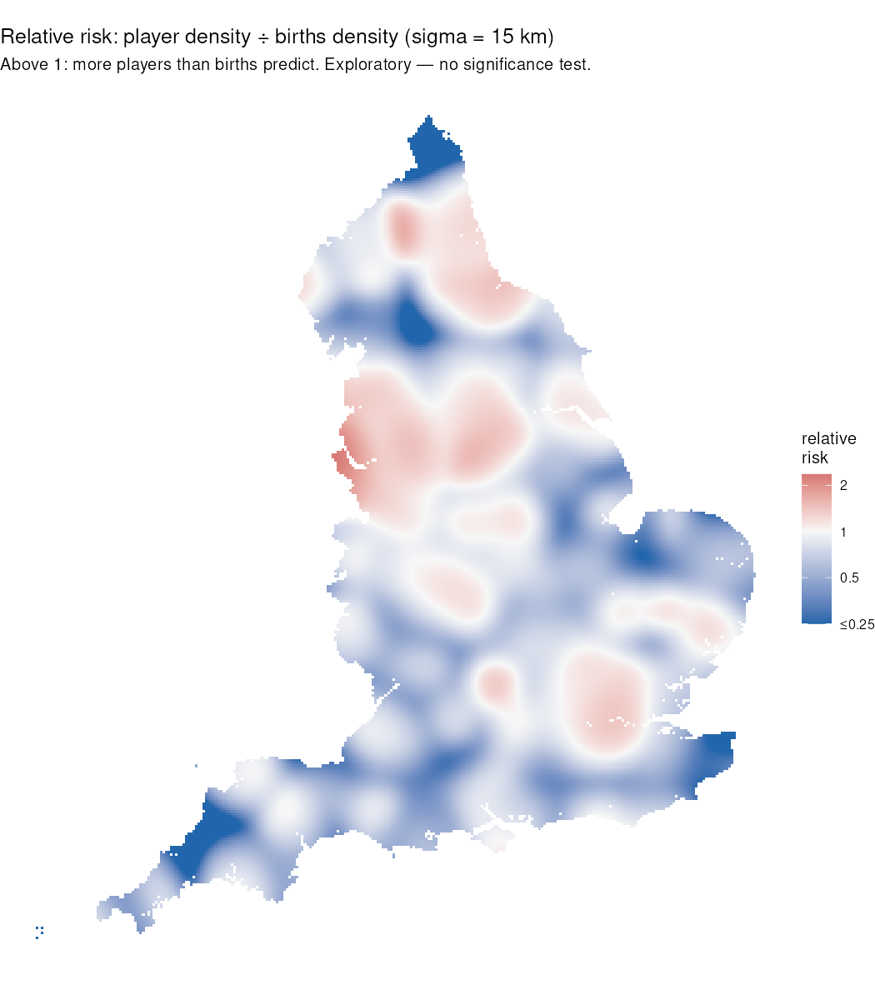
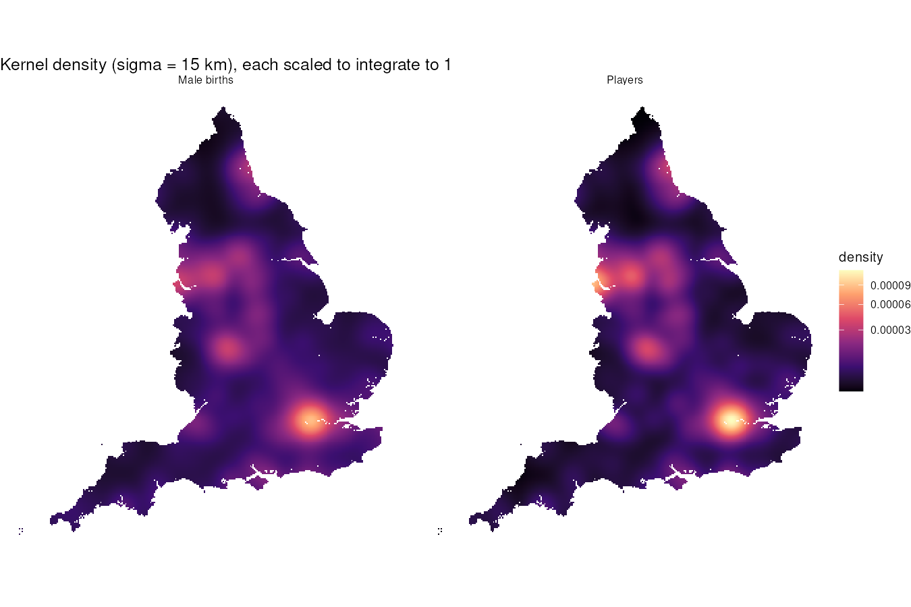

# Step 5 Report: RQ1, Clustering Beyond Births

**Project:** football-talent-hotspots, i.e. where England's Premier League and Championship footballers come from
**Author:** Dennis Wambua
**Step:** 5 of 8
**Completed:** 18 November 2026
**Related:** [Work Plan](../WORKPLAN.md) · [Step 4 Report](step4_report.md) · [Statistical Methods](../STATISTICAL_METHODS.md) (sections 3–4) · [Proposal v2.1](../Talent_Hotspots_Technical_Research_Proposal.pdf)

---

## 1. Research question

> **RQ1.** Are the birthplaces of English-born Premier League and Championship players more clustered than births alone would predict?

- **H0 (null):** players are born where boys are born; every place produces players in proportion to its births.
- **H1:** players are concentrated in some places beyond what births explain.

---

## 2. Answer

**Yes. H0 is rejected at two scales:**

1. **Regional scale: strong evidence.** Players per birth differ greatly between English regions. A boy born in **London** or the **North West** was about **2.4 times** as likely to reach the top two divisions as a boy born in the **South West**. Seven of the nine regions differ significantly from the national rate.
2. **Local to sub-regional scale (up to 60 km): modest but significant evidence.** Player birthplaces are more bunched together than births would produce (global DCLF test p = 0.022 over 0–60 km; p = 0.031 over 20–60 km). The effect is consistent but small.

A **null test** with fake players placed purely according to births found **no** clustering (p ≈ 0.5), which shows the method doesn't create clustering by itself.

---

## 3. Results

### 3.1 Players per birth by region

| Region | Male births 1975–2005 | Players | Per 10,000 births | Expected | **SR** | Poisson p |
|---|---|---|---|---|---|---|
| London | 1,522,804 | 695 | 4.56 | 481.5 | **1.44** | < 0.0001 |
| North West | 1,371,339 | 588 | 4.29 | 433.6 | **1.36** | < 0.0001 |
| North East | 498,729 | 184 | 3.69 | 157.7 | **1.17** | 0.04 |
| Yorkshire and The Humber | 978,189 | 341 | 3.49 | 309.3 | 1.10 | 0.07 |
| West Midlands | 1,064,039 | 312 | 2.93 | 336.4 | 0.93 | 0.19 |
| East of England | 1,014,179 | 252 | 2.48 | 320.7 | **0.79** | < 0.0001 |
| East Midlands | 782,387 | 175 | 2.24 | 247.4 | **0.71** | < 0.0001 |
| South East | 1,469,056 | 313 | 2.13 | 464.5 | **0.67** | < 0.0001 |
| South West | 840,759 | 157 | 1.87 | 265.8 | **0.59** | < 0.0001 |
| **England** | **9,541,482** | **3,017** | **3.16** | | 1.00 | |

There's a clear **north-west / south-east gradient with London as the exception**. The North West, North East and London produce more players than their births predict; the South West, South East, East Midlands and East of England produce fewer. The West Midlands and Yorkshire are close to the national rate.

The table includes all 3,017 placed players. The 98 players recorded only as "born in London" are counted in London.

### 3.2 Inhomogeneous L-function



**How to read it:**
- The **red line** shows how many neighbours a player's birthplace has within distance *r*, compared with what births predict.
- The **grey band** shows what 999 sets of births-only fake players produce (95% global envelope).
- Above zero means more bunched than births; above the grey band means significantly more.

| Distance r | Observed L(r) − r | 95% envelope |
|---|---|---|
| 2 km | **+8.2** | −7.3 to +7.1 |
| 5 km | +6.1 | −7.3 to +7.1 |
| 10 km | +5.5 | −7.3 to +7.0 |
| 20 km | +6.5 | −7.3 to +7.1 |
| 30 km | +6.9 | −7.2 to +7.1 |
| 40 km | +5.8 | −7.1 to +7.3 |
| 50 km | +4.3 | −6.8 to +7.5 |
| 60 km | +2.8 | −6.8 to +7.6 |

**Global tests** (one test over the whole range; avoids testing each distance separately):

| Range | MAD test | DCLF test | Interpretation |
|---|---|---|---|
| 0–60 km | p = **0.032** | p = **0.022** | Significant clustering beyond births |
| 20–60 km | p = 0.051 | p = **0.031** | Significant (DCLF) / borderline (MAD) at the regional scale |
| Null test, 0–60 km | p = 0.50 | — | No false clustering ✓ |
| Null test, 20–60 km | p = 0.48 | — | No false clustering ✓ |

The observed curve sits **consistently above zero (about +6 km)** at every distance. It only rises above the 95% band at 1–3 km, the range most affected by shared town-centre coordinates and the hospital effect (§5). The DCLF test is more sensitive than MAD to a consistent but modest excess across many distances, which is the pattern seen here. That's why DCLF is significant at 20–60 km while MAD is borderline.

### 3.3 Where the excess is: relative-risk surface



Player density divided by births density (both smoothed at 15 km). It's exploratory, with no significance test; Step 6 does the formal hotspot tests.
- **Above 1 (red):** Merseyside and Cheshire, Greater Manchester and Lancashire, South Yorkshire, the North East (Durham, Teesside), parts of the West Midlands and Essex.
- **Below 1 (blue):** Cornwall and Devon, Somerset and Wiltshire, Kent, Norfolk and Suffolk, Northumberland, and Cumbria / North Yorkshire.

London appears close to 1 here because the 98 "London"-only players can't be placed as points; the regional table, which includes them, shows London clearly above expected.



---

## 4. Method

| Element | Choice | Why |
|---|---|---|
| Points | 2,919 English-born players with town-level birthplaces, in British National Grid (km) | Points need a precise location; "London"-only birthplaces can't be used |
| Jitter | ±0.5 km, fixed seed | Many players share one town-centre coordinate (e.g. 106 at "Liverpool") |
| Window | England (union of local authorities), simplified to 0.5 km | Study area |
| Background (null) intensity | Male births 1975–2005, shared from local authorities to LSOA centroids, kernel-smoothed (σ = 2 km), scaled to n players | Same baseline as the expected counts; fine σ captures towns and cities |
| Statistic | Inhomogeneous L-function, border edge correction | Tests clustering relative to a varying background |
| Distances | r = 0–60 km | Beyond ~60 km the border correction leaves too few points in a country as narrow as England |
| Null simulations | 999 patterns of n points drawn from the births intensity | Proposal requirement |
| Envelope | 95% global envelope (nrank = 50) | Matches the 5% global tests |
| Tests | Global MAD and DCLF, over 0–60 km and 20–60 km | 20–60 km avoids the short-range artefacts |
| Null test | One births-only fake pattern + 199 simulations | Checks that the method doesn't create false clustering |
| Regions | Players per 10,000 male births; exact Poisson test of observed vs. expected | Regional view of the same question |

Script: `R/05_clustering.R`. Runtime about 5 minutes with 999 simulations.

---

## 5. Challenges and how they were solved

| # | Challenge | Solution |
|---|---|---|
| 1 | **Undefined values at long distances.** With border correction, at r = 100 km almost no point is 100 km from England's coast, so the L-function was undefined. | Capped the range at **60 km**; no undefined values remain. |
| 2 | **Envelope too wide.** With 999 simulations, spatstat's default global envelope is the extreme (99.9%) band, so the plot didn't match the 5% tests. | Set `nrank = 50` for a **95%** global envelope. The test p-values were unaffected. |
| 3 | **Shared coordinates.** Many players have identical town-centre points, which inflates clustering at very short distances. | ±0.5 km jitter, and a separate test over 20–60 km. |
| 4 | **Hospital effect.** Births are counted by mother's home, players by hospital town (Step 4). That creates artificial clustering at hospital-catchment scale (~5–20 km). | Interpret short distances cautiously; rely on the 20–60 km test and the regional analysis. |
| 5 | **"London" birthplaces** can't be points. | Excluded from the point analysis, included in the regional table. |
| 6 | Small fixes: reference-curve name (`mmean`), test-statistic format, window after jitter, harmless spatstat label warnings. | Fixed in the script. |

---

## 6. Limitations

1. **Short-distance results are unreliable** (below about 20 km), because of shared coordinates and the hospital effect. The 1–3 km exceedance of the envelope shouldn't be read as "very local hotspots".
2. **Modest effect size.** The local clustering is statistically significant but small (L(r) − r ≈ +6 km). Most of the variation is **regional** (first-order), not local bunching.
3. **The London undercount in the point analysis** (98 players without a precise birthplace) weakens London's contribution to the L-function and the relative-risk map.
4. **The background intensity depends on the smoothing bandwidth** (σ = 2 km). A much coarser σ would understate urban concentration of births and overstate clustering. σ = 2 km keeps the births surface as fine as the LSOA data allows.
5. **Window simplification** (0.5 km tolerance) and the 60 km cap are practical choices. They don't change the conclusion but limit how far the L-function can look.
6. The **null test uses 199 simulations** (not 999) to save time. It's only a check that the method doesn't produce false positives.
7. All Step 2–4 limitations still apply: Wikipedia/Wikidata coverage, birthplace ≠ where a player grew up, and the births proxy.

---

## 7. What this means for the next steps

- **Step 6 (RQ2, where?):** the evidence points to **regional** concentration. Hotspot tests on the **155 TTWAs** (Empirical Bayes-smoothed SR, EB Moran's I, Getis-Ord Gi\*, LISA with FDR correction) should find **hotspots in the North West, North East, South Yorkshire and London**, and **coldspots in the South West, South East and East Anglia**, if the relative-risk map is right.
- **Step 7 (RQ3, why?):** the strong north–south pattern makes **region fixed effects** important in the models, otherwise deprivation could simply stand in for "North". Comparing models with and without region effects will show whether deprivation, urbanisation or club distance explain differences *within* regions.

---

## 8. How to reproduce

Inside the app container, after Steps 2–4:

```bash
python python/11_ons_boundaries.py   # includes the LAD -> region lookup
Rscript R/05_clustering.R 999        # ~5 min; use e.g. 19 for a quick trial
```

Outputs: `data/processed/step5_regions.csv`, `step5_tests.csv`, `step5_linhom_envelope.csv`, and `docs/reports/figures/step5_*.png`.

---

## Sources

- Baddeley, A., Møller, J., & Waagepetersen, R. (2000). Non- and semi-parametric estimation of interaction in inhomogeneous point patterns. *Statistica Neerlandica, 54*(3), 329–350.
- Baddeley, A., Rubak, E., & Turner, R. (2015). *Spatial Point Patterns: Methodology and Applications with R*. CRC Press. (spatstat 3.4)
- Office for National Statistics: Local Authority District to Region (December 2021) lookup. Open Government Licence v3.0.
- Players, births and boundaries as in the Step 2–4 reports.
