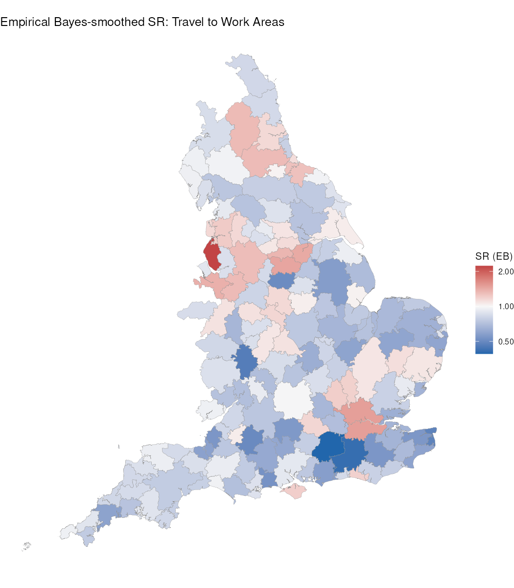
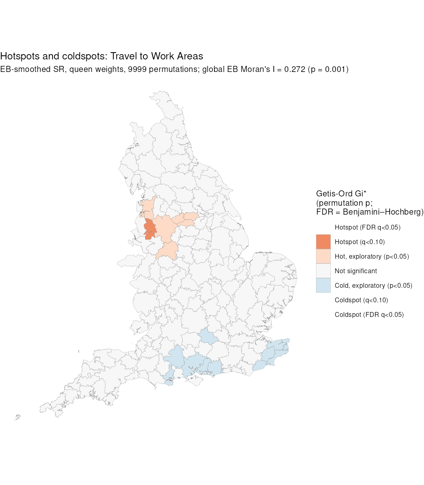
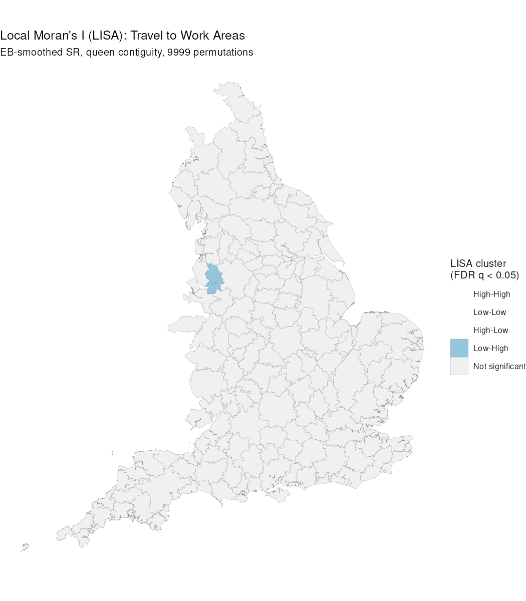
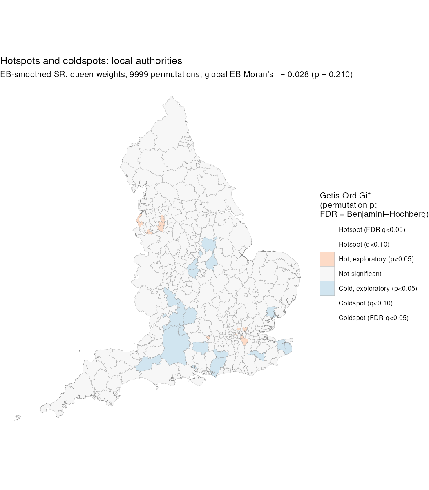
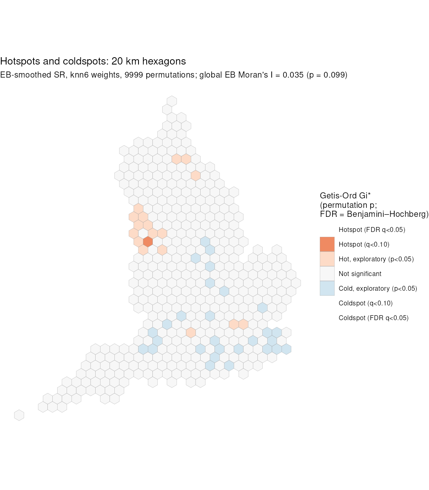

# Step 6 Report: RQ2, Where Are the Hotspots?

**Project:** football-talent-hotspots, i.e. where England's Premier League and Championship footballers come from
**Author:** Dennis Wambua
**Step:** 6 of 8 (Milestone M3: hotspot maps)
**Completed:** 18 November 2026
**Related:** [Work Plan](../WORKPLAN.md) · [Step 4 Report](step4_report.md) · [Step 5 Report](step5_report.md) · [Statistical Methods](../STATISTICAL_METHODS.md) (sections 2, 5–7)

---

## 1. Research question

> **RQ2.** Where in England are the statistically significant hotspots and coldspots of player production?

- **H1:** some areas produce significantly more (hotspots) or fewer (coldspots) players than their births predict.

---

## 2. Answer

1. **Areas cluster: strong evidence.** At Travel to Work Area (TTWA) level, areas that produce many players sit next to other high areas, and low next to low: **EB Moran's I = 0.27, p = 0.001**, with both neighbour definitions.
2. **The clustering is a broad gradient, not sharp local hotspots.** High production runs across the **North West (Merseyside, Lancashire, Greater Manchester) and the Pennine belt into South Yorkshire**. Low production runs along the **South coast, Kent and parts of the South and Midlands**.
3. **No single area survives the strictest test.** With permutation tests and false-discovery-rate (FDR) correction across 155 areas, no TTWA reaches q < 0.05. The strongest is **Warrington & Wigan (q = 0.06)**, which sits between the high areas of Liverpool, Manchester and Preston. Under a normal-theory test (sensitivity analysis), **5 North West / Yorkshire areas** pass FDR: Warrington & Wigan, Preston, Liverpool, Barnsley and Manchester.

**H1 is supported for the overall pattern** (global clustering, regional gradient), but **only weakly for individually named hotspots.** The talent map of England is a gradient across the country, not a few isolated hotspots.

---

## 3. Results

### 3.1 Global clustering (EB Moran's I, 999 permutations)

| Unit | Neighbours | Areas | EB Moran's I | p |
|---|---|---|---|---|
| **TTWA (main)** | Shared border (queen) | 155 | **0.272** | **0.001** |
| TTWA | 6 nearest | 155 | **0.258** | **0.001** |
| Local authority | Shared border | 309 | 0.028 | 0.21 |
| Local authority | 6 nearest | 309 | 0.053 | 0.039 |
| 20 km hexagons | 6 nearest | 439 | 0.035 | 0.099 |
| 20 km hexagons | 4 nearest | 439 | 0.022 | 0.22 |
| 20 km hexagons | 8 nearest | 439 | 0.048 | 0.015 |

Clustering is strong and stable at TTWA level and weak at finer levels. That's expected: local authorities are distorted by the hospital effect (Step 4), and 20 km hexagons are sparse (median 2.6 expected players), which adds noise that hides the pattern.

### 3.2 Smoothed production by TTWA



Empirical Bayes smoothing pulls small, unreliable areas toward the national average. The raw SR range of 0.00–2.35 becomes **0.39–2.23**.

| Highest (EB-smoothed SR) | O | E | Raw SR | **EB SR** | | Lowest (EB-smoothed SR) | O | E | Raw SR | **EB SR** |
|---|---|---|---|---|---|---|---|---|---|---|
| Liverpool | 156 | 66.2 | 2.35 | **2.23** | | Guildford & Aldershot | 10 | 36.1 | 0.28 | **0.39** |
| London | 690 | 459.7 | 1.50 | **1.49** | | Crawley | 9 | 31.4 | 0.29 | **0.41** |
| Sheffield | 73 | 48.2 | 1.51 | **1.45** | | Worcester & Kidderminster | 4 | 16.6 | 0.24 | **0.46** |
| Doncaster | 30 | 19.1 | 1.57 | **1.42** | | Margate & Ramsgate | 1 | 9.4 | 0.11 | **0.48** |
| Chester | 18 | 11.2 | 1.61 | **1.38** | | Trowbridge | 3 | 12.6 | 0.24 | **0.50** |
| Barnsley | 23 | 15.3 | 1.50 | **1.35** | | Chesterfield | 3 | 12.4 | 0.24 | **0.51** |
| Hexham | 5 | 2.2 | 2.27 | **1.31** | | Bournemouth | 5 | 15.4 | 0.32 | **0.53** |
| Crewe | 24 | 16.7 | 1.44 | **1.31** | | Tunbridge Wells | 5 | 14.8 | 0.34 | **0.55** |

Smoothing works as intended. Hexham's raw 2.27 (5 players against 2.2 expected) is pulled down to 1.31, while Liverpool (156 players) barely moves.

**Liverpool is the single strongest area in England**, producing 2.2× the players its births predict.

### 3.3 Local hotspots: Getis-Ord Gi\* (9,999 permutations)



Gi\* asks whether an area **and its neighbours together** are unusually high or low. Results by evidence tier (TTWA, shared-border neighbours):

| Evidence tier | 🔴 Hot | 🔵 Cold |
|---|---|---|
| **FDR q < 0.05** (strict) | — | — |
| **q < 0.10** | Warrington & Wigan (z = 5.15, q = 0.062) | — |
| **p < 0.05 unadjusted** (exploratory) | Preston (z 4.23), Barnsley (3.82), Manchester (3.30), Wakefield & Castleford (2.60), Huddersfield (2.53), Stoke-on-Trent (2.18) | Chichester & Bognor (−2.58), Canterbury (−2.57), Ashford (−2.40), Margate & Ramsgate (−2.36), Folkestone & Dover (−2.36), Salisbury (−2.12), Hastings, Portsmouth, Southampton, Poole, Reading |

**Why Warrington & Wigan and not Liverpool?** Gi\* finds **clusters**. Warrington & Wigan itself is slightly below expected (SR 0.85), but it's surrounded by high areas: Liverpool, Manchester, Preston, Chester. Liverpool's own neighbours are more mixed, so as a *cluster* it's less extreme even though it's the highest single area. LISA flags Warrington & Wigan as **Low-High** (a lower area inside a high neighbourhood), which supports this reading.

**With the alternative neighbour definition (6 nearest TTWAs):** six areas reach q < 0.10. Hot: **Warrington & Wigan, Birkenhead**. Cold: **Ashford, Folkestone & Dover, Medway, Margate & Ramsgate** (q 0.06–0.09).



### 3.4 Sensitivity: normal-theory p-values

Using the standard normal approximation for Gi\* instead of permutations, **5 TTWAs are hotspots after FDR (q < 0.05)**: Warrington & Wigan (q = 0.00004), Preston (0.002), **Liverpool** (0.003), Barnsley (0.005) and Manchester (0.03). No coldspots pass. With 6-nearest neighbours: 9 hot and 3 cold.

The permutation test is the main result because SR values are **skewed** (Liverpool is an extreme outlier), which breaks the normal approximation. The normal-theory result shows that the North West / Yorkshire belt is the most robust signal.

### 3.5 Other scales

| Scale | Strongest areas, unadjusted p < 0.05 | Smallest FDR q |
|---|---|---|
| Local authorities | Hot: City of London, Sefton, Lewisham, Trafford, Halton, Salford, Bury, Bromley · Cold: NW Leicestershire, Cotswold, Wiltshire, Waverley, Wychavon, Canterbury, Newark & Sherwood, West Oxfordshire | 0.26 |
| 20 km hexagons | Hot hexagons around Merseyside / Greater Manchester and London · Cold in rural South and Midlands | 0.09 |




**All scales tell the same story:** Merseyside and Greater Manchester boroughs (Sefton, Trafford, Halton, Salford, Bury) and parts of London are high; rural southern and Midlands districts are low.

### 3.6 Robustness of the classification

| Comparison | Agreement |
|---|---|
| TTWA queen vs. 6-nearest: hot / cold / neither (p < 0.05) | **87%** |
| TTWA queen vs. 6-nearest: Gi\* z-scores | correlation **0.90** |

---

## 4. Method

| Element | Choice |
|---|---|
| Variable | SR = observed / expected (main variant, Step 4), **Empirical Bayes-smoothed** (Poisson, shrinkage to the England mean; `spdep::EBest`) |
| Units | 155 TTWAs (main); 309 local authorities and 439 hexagons of 20 km (comparison) |
| Neighbours | TTWA and local authorities: shared border (queen). The Isle of Wight and the Isles of Scilly have no land neighbour, so each is linked to its nearest area. Alternative: 6 nearest. Hexagons: 6 nearest (alternatives 4 and 8), made symmetric |
| Global test | EB Moran's I (Assunção & Reis), 999 permutations |
| Local tests | Getis-Ord Gi\* (binary weights including the area itself) and LISA (row-standardised), **9,999 conditional permutations** |
| Multiple testing | Benjamini–Hochberg FDR across areas; significance at q < 0.05, with q < 0.10 and unadjusted p < 0.05 shown as weaker tiers |
| Sensitivity | Normal-theory Gi\* p-values with FDR |

Script: `R/06_hotspots.R` (about 2 minutes).

---

## 5. Challenges and how they were solved

| # | Challenge | What happened | Solution |
|---|---|---|---|
| 1 | **999 permutations can't pass FDR** | With 999 permutations the smallest possible p-value is 0.001. FDR across 155 areas needs the strongest area below 0.05 ÷ 155 = 0.0003, so no area could ever be significant, however strong. | **9,999 permutations** for local tests (minimum p = 0.0001). Global Moran's I keeps 999. |
| 2 | **Strong global clustering but no FDR-significant area** | Even with 9,999 permutations no TTWA passed q < 0.05. | Checked it isn't an error (z-scores up to 5.15; unadjusted p down to 0.0004). Results are shown in evidence tiers, plus a normal-theory sensitivity analysis, instead of an empty map. |
| 3 | **Skewed values** | Liverpool's SR (2.2) is far above all other areas, which makes permutation distributions heavy-tailed and normal-theory p-values too optimistic. | Permutation test as the main result, normal theory as sensitivity. |
| 4 | **Islands** | The Isle of Wight and the Isles of Scilly share no border with the mainland. | Linked to their nearest area (documented in the script output). |
| 5 | **Earlier artefacts** | The hospital effect and the "London" birthplace point (Step 4). | Handled by the TTWA main unit. |

---

## 6. Limitations

1. **Limited power for individual areas.** With 155 areas and modest numbers in many (40 expect fewer than 5 players), FDR correction is demanding. Real but moderate local clusters may not reach q < 0.05. The absence of FDR-significant areas means *the evidence for any single named hotspot is weak*, **not** that the pattern is random (global Moran's I is p = 0.001).
2. **Gi\* measures neighbourhoods, not single areas.** A strong single area surrounded by average areas (e.g. Liverpool, London) can be missed by Gi\*. The EB-smoothed SR table (§3.2) is the better guide to individual areas.
3. **Results depend on scale.** Local authority and hexagon results are much weaker (hospital effect, sparse data). The TTWA result is the most trustworthy, but it depends on the 2011 TTWA boundaries.
4. **Global EB shrinkage.** Smoothing pulls toward the England average, not toward neighbours. A spatial (local) EB or a Bayesian BYM2 model (optional in the plan) could separate area and neighbourhood effects better.
5. **Unadjusted p < 0.05 results are exploratory.** With 155 tests, about 8 areas would pass by chance; 18 did. That's more than chance, but any individual one may be a false positive.
6. Earlier limitations still apply (data coverage, birthplace ≠ where a player grew up, births proxy).

---

## 7. Deviations from the proposal (v2.1)

| Proposal | What was done | Reason |
|---|---|---|
| 999 permutations for local Gi\* and LISA | **9,999** for local tests (999 for global) | 999 can't reach the FDR threshold with 155+ areas |
| Main unit: local authorities | TTWAs (decided in Step 4); local authorities and hexagons as comparison | Hospital effect |
| Scales: local authority, 10 km, 20 km | TTWA, local authority, 20 km (10 km dropped) | 10 km hexagons too sparse (Step 4) |
| Inverse distance (30 km) as alternative weights for polygons | 6 nearest neighbours | Works for areas of very different size (TTWAs range from small towns to London) |
| Significance at FDR q < 0.05 only | q < 0.05, plus q < 0.10 and unadjusted p < 0.05 tiers, plus normal-theory sensitivity | Show the strength of evidence instead of an empty map |

---

## 8. What this means for Step 7 (RQ3: why?)

- **The main pattern is regional**, so the regression needs **region fixed effects**. Otherwise deprivation or urbanisation might just stand in for "the North".
- **Spatial autocorrelation is strong at TTWA level** (I = 0.27), so model residuals are likely to be spatially correlated. That makes the Lagrange Multiplier tests and spatial error / lag models necessary.
- The robustness variants (certain-only, Premier League, cohorts, population baseline) should be rerun through the same Gi\* pipeline to check the North West / South-coast pattern holds.

---

## 9. How to reproduce

Inside the app container, after Steps 2–4:

```bash
Rscript R/06_hotspots.R 999 9999     # global / local permutations (~2 min)
```

Outputs: `data/processed/step6_global.csv`, `step6_{ttwa,lad21,hex20}_{weights}.csv` (one row per area: O, E, SR, SR_EB, Gi z / p / q, normal-theory q, LISA, classes), and `docs/reports/figures/step6_*.png`.

---

## Sources

- Anselin, L. (1995). Local indicators of spatial association—LISA. *Geographical Analysis, 27*(2), 93–115.
- Assunção, R. M., & Reis, E. A. (1999). A new proposal to adjust Moran's I for population density. *Statistics in Medicine, 18*(16), 2147–2162.
- Benjamini, Y., & Hochberg, Y. (1995). Controlling the false discovery rate. *Journal of the Royal Statistical Society: Series B, 57*(1), 289–300.
- Getis, A., & Ord, J. K. (1992). The analysis of spatial association by use of distance statistics. *Geographical Analysis, 24*(3), 189–206.
- Bivand, R. et al. spdep: Spatial Dependence: Weighting Schemes, Statistics (version 1.4-1).
