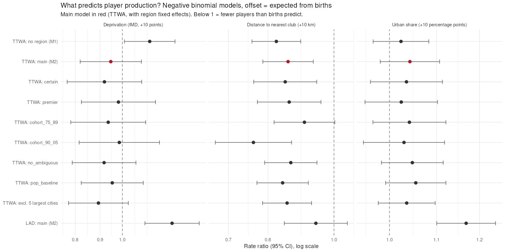
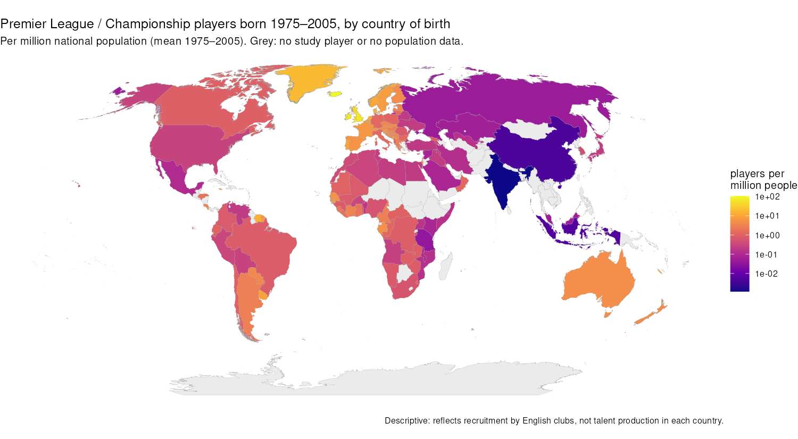
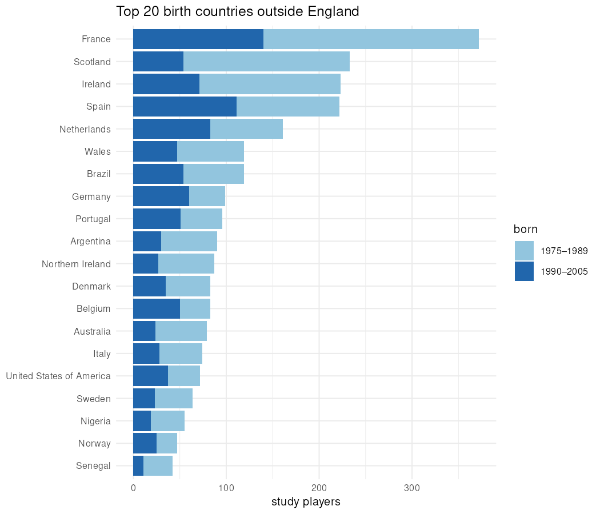

# Step 7 Report: RQ3 (Why?) and RQ4 (Foreign-Born Players)

**Project:** football-talent-hotspots, i.e. where England's Premier League and Championship footballers come from
**Author:** Dennis Wambua
**Step:** 7 of 8 (Milestone M4: models, robustness and foreign-born supply)
**Completed:** 18 November 2026
**Related:** [Work Plan](../WORKPLAN.md) · [Step 5 Report](step5_report.md) · [Step 6 Report](step6_report.md) · [Statistical Methods](../STATISTICAL_METHODS.md) (sections 8–10)

---

## 1. Research questions

> **RQ3.** Is hotspot intensity associated with deprivation, urbanisation or proximity to professional clubs and academies, after controlling for births?
> **RQ4 (descriptive).** Which countries supply foreign-born players to the two leagues, and how has this changed across birth cohorts?

- **H2:** player production (relative to births) is associated with deprivation, urbanisation and proximity to clubs and academies.

---

## 2. Answers

### RQ3
1. **Distance to a professional club is the clearest and most robust predictor.** Each extra **10 km** between an area's children (at age 12) and the nearest league club means **about 14% fewer players** than births predict (rate ratio 0.86, 95% CI 0.79–0.93, p = 0.0004). It holds in every robustness check, and it's **stronger for players born 1990–2005** (0.76) than for those born 1975–89 (0.91).
2. **Being near a club matters, not being near an elite academy.** For players born 1996–2005, distance to the nearest **Category 1 academy** has **no** effect (rate ratio 1.00, p = 0.93), while distance to **any** professional club has a strong one (0.74 per 10 km, p < 0.001).
3. **Deprivation is a proxy for region.** More deprived areas seem to produce more players (rate ratio 1.14 per 10 IMD points, p = 0.03), but the effect **disappears once region is accounted for** (0.95, p = 0.46). Deprived areas are mostly in the North, which produces more players for other reasons.
4. **Urban share has no effect** (rate ratio 1.04, p = 0.18).
5. **Region matters in its own right.** Compared with the West Midlands, the North West and North East produce **39% more** players per birth, and the South East and South West **about 22% fewer**, after allowing for deprivation, urbanisation and distance.
6. **No spatial model is needed.** Region effects remove the leftover spatial clustering in the residuals, and spatial error and lag models add nothing.

**H2 is partly supported:** yes for proximity to clubs, no for deprivation (once region is included), urbanisation and elite academies.

### RQ4
- The 6,581 study players were born in **143 countries / UK nations**: **46.8% England**, 6.7% Scotland, Wales and Northern Ireland, **46.3% outside the UK**.
- **Largest suppliers:** France (372), Scotland (233), Ireland (223), Spain (222), Netherlands (161), Brazil (119), Wales (119).
- **Per million people:** Iceland (106), England (64), Ireland (62), Scotland (46) and Wales (41) are far ahead of everyone else.
- **Over time:** England's share rose from 45% to 49%, and the other UK nations fell sharply (8.1% → 4.6%; Scotland 179 → 54 players). Among players from outside the UK, Europe grew (63% → 67%) and Africa fell (14% → 11%).

---

## 3. RQ3 results

### 3.1 Main models (155 TTWAs, negative binomial, offset = expected players from births)

| Model | AIC | Log-likelihood | θ (overdispersion) |
|---|---|---|---|
| M0 baseline (no covariates) | 878 | −437 | 5.4 |
| M1 + deprivation, urban share, club distance | 831 | −411 | 11.2 |
| **M2 + region fixed effects (main)** | **823** | **−398** | 15.6 |

- **Why negative binomial:** a Poisson model has dispersion 2.28 (it should be about 1), so the counts vary more than Poisson allows.
- **Region effects improve the model:** likelihood ratio χ² = 24.8, df = 8, **p = 0.002**.
- **Multicollinearity is low:** VIF = 1.41 (deprivation), 1.82 (urban share), 1.67 (club distance).

| Variable (per unit) | M1: without region | **M2: with region (main)** |
|---|---|---|
| Deprivation (+10 IMD points) | 1.14 (1.01–1.28), p = 0.034 | **0.95** (0.82–1.10), p = 0.46 |
| Urban share (+10 percentage points) | 1.02 (0.97–1.08), p = 0.42 | **1.04** (0.98–1.11), p = 0.18 |
| Distance to nearest club (+10 km) | 0.82 (0.76–0.89), p < 0.0001 | **0.86 (0.79–0.93), p = 0.0004** |

Rate ratios with 95% confidence intervals. Below 1 means fewer players than births predict.

**Region effects (M2, vs. West Midlands):**

| North West | North East | Yorkshire & Humber | London | East of England | East Midlands | South East | South West |
|---|---|---|---|---|---|---|---|
| **1.39** | **1.39** | 1.17 | 1.10 | 0.99 | 0.83 | **0.78** | **0.77** |



### 3.2 Spatial dependence

| Check | Result |
|---|---|
| Moran's I of M1 residuals (no region) | **0.168, p = 0.002** (leftover spatial pattern) |
| Moran's I of M2 residuals (with region) | 0.033, p = 0.26 (none left) |
| Robust LM test, error | p = 0.30 |
| Robust LM test, lag | p = 0.35 |
| Spatial error model λ | 0.07, p = 0.56 |
| Spatial lag model ρ | 0.03, p = 0.77 |
| AIC: OLS / spatial error / spatial lag (on log smoothed SR) | **6.2** / 7.8 / 8.1 |
| Club distance in the spatial models | ratio 0.965 per 10 km, p = 0.014–0.019 (all three) |

The spatial clustering found in Step 6 is explained by the **regional pattern**. Once regions are included, neighbouring areas aren't more alike than the model expects, so no spatial error or lag term is needed. The spatial models give the same answer for club distance. Their estimates are on the log of the *smoothed* SR, which is pulled toward 1, so they're smaller in size.

### 3.3 Robustness (main model M2, rate ratio per +10 km to the nearest club)

| Variant | Distance RR | p | Deprivation RR | Urban RR |
|---|---|---|---|---|
| **Main** | **0.86** | **0.0004** | 0.95 | 1.04 |
| Certain appearance evidence only | 0.85 | 0.002 | 0.92 | 1.03 |
| Premier League players only | 0.86 | 0.006 | 0.98 | 1.02 |
| Born 1975–1989 | 0.91 | 0.057 | 0.94 | 1.04 |
| Born 1990–2005 | **0.76** | **< 0.0001** | 0.99 | 1.03 |
| Excluding season-ambiguous players | 0.86 | 0.001 | 0.92 | 1.05 |
| Total-population baseline | 0.84 | < 0.0001 | 0.95 | 1.06 |
| Excluding London, Birmingham, Manchester, Liverpool, Leeds | 0.85 | 0.0002 | 0.89 | 1.04 |
| Local authorities instead of TTWAs | 0.94 | 0.26 | **1.27** | **1.17** |

- The **distance effect** is below 1 in every variant and significant in all but one (the older cohort, p = 0.057).
- **Deprivation and urban share** are never significant at TTWA level.
- The **local authority result is the exception**: distance becomes non-significant and deprivation and urban share turn strongly positive. That's the **hospital effect** (Step 4). Births are recorded at the maternity-hospital town, and those towns are urban and often more deprived. The local authority model picks up hospital locations, not football, which confirms that TTWAs were the right main unit.

### 3.4 Academy-era sub-model (players born 1996–2005)

These cohorts were aged 16 or under when the Elite Player Performance Plan (EPPP) started in 2012/13. **594 players**, 155 TTWAs.

**Category 1 academy list** (`data/manual/category1_academies.csv`): only Category 1 academies play in the national U18 league ("League 1"), so each season's League 1 clubs on Wikipedia give that season's Category 1 academies. That's **21–26 per season and 28 clubs over 2012/13–2021/22**, each row with its source article and revision id. The two seasons with no article (2012/13, 2021/22) were filled from the nearest season.

| Model | Club distance RR (+10 km) | Academy distance RR (+10 km) | AIC |
|---|---|---|---|
| A1 club distance | **0.74** (0.62–0.88), p = 0.0007 | — | **469** |
| A2 academy distance | — | 1.00 (0.95–1.05), p = 0.93 | 482 |
| A3 both | **0.73** (0.61–0.87), p = 0.0004 | 1.03 (0.97–1.08), p = 0.36 | 470 |

Median distance: 20.5 km to a club, 52 km to a Category 1 academy (correlation 0.62). Even after EPPP, **what predicts reaching the top two divisions is having a professional club nearby, not an elite academy nearby.** This fits a pathway where boys join their local club first and the most promising move to elite academies later.

---

## 4. RQ4 results: foreign-born and other UK-born players




### 4.1 Where players are born

| Born in | 1975–1989 | 1990–2005 | All |
|---|---|---|---|
| England | 1,725 (45.2%) | 1,356 (49.1%) | 3,081 (46.8%) |
| Scotland, Wales, Northern Ireland | 311 (8.1%) | 128 (4.6%) | 439 (6.7%) |
| Outside the UK | 1,776 (46.5%) | 1,270 (45.9%) | 3,046 (46.3%) |
| Unknown | 5 | 10 | 15 |

### 4.2 Top countries outside England

| Country | Born 1975–89 | Born 1990–2005 | Total | Per million people |
|---|---|---|---|---|
| France | 232 | 140 | 372 | 6.4 |
| Scotland | 179 | 54 | 233 | 45.7 |
| Ireland | 152 | 71 | 223 | 62.0 |
| Spain | 111 | 111 | 222 | 5.7 |
| Netherlands | 78 | 83 | 161 | 10.7 |
| Brazil | 65 | 54 | 119 | 0.8 |
| Wales | 72 | 47 | 119 | 41.4 |
| Germany | 39 | 60 | 99 | 1.2 |
| Portugal | 45 | 51 | 96 | 9.6 |
| Argentina | 60 | 30 | 90 | 2.8 |
| Northern Ireland | 60 | 27 | 87 | — |
| Belgium | 33 | 50 | 83 | 8.3 |
| Denmark | 48 | 35 | 83 | 16.0 |
| Australia | 55 | 24 | 79 | 4.7 |
| Italy | 46 | 28 | 74 | 1.3 |
| United States | 35 | 37 | 72 | 0.3 |

**Highest per million** (countries with ≥ 10 players): Iceland 106, England 64, Ireland 62, Scotland 46, Wales 41, Denmark 16, Jamaica 12, Norway 11, Netherlands 11, Portugal 10.

### 4.3 Continents (players born outside the UK)

| Continent | 1975–1989 | 1990–2005 |
|---|---|---|
| Europe | 63.1% | 66.9% |
| Africa | 13.5% | 11.4% |
| South America | 10.8% | 10.0% |
| North America | 6.0% | 5.2% |
| Oceania | 3.8% | 2.3% |
| Asia | 2.9% | 4.3% |

### 4.4 Interpretation
- **Close neighbours supply the most per head.** Ireland, Iceland and the other UK nations sit far above everyone else per million people. Language, proximity and long-standing recruitment links matter.
- **Fewer Scottish, Welsh and Northern Irish players in the younger cohort.** Scotland fell from 179 to 54. Part of this is because the 1990–2005 cohort is younger and incomplete, but the fall is much steeper than for England.
- **Germany (39 → 60), Belgium (33 → 50), the Netherlands and Portugal grew**; Argentina (60 → 30), Australia (55 → 24), Denmark (48 → 35) and Sweden (41 → 23) shrank. The younger cohort is incomplete, so falls are partly a recording effect, but the rises are not.
- These are **recruitment patterns of English clubs**, not talent production in each country. Brazil's 0.8 per million says nothing about Brazilian football.

---

## 5. Method summary

| Part | Method | Script |
|---|---|---|
| Main models | Negative binomial (`MASS::glm.nb`), offset log E, covariates per TTWA, region = the region holding most of the TTWA's population | `analysis/models/07_models.R` |
| Collinearity | VIF from auxiliary regressions | `analysis/models/07_models.R` |
| Spatial checks | Moran's I of Pearson residuals (999 permutations); robust LM tests (`spdep::lm.RStests`); `spatialreg::errorsarlm` / `lagsarlm` on log smoothed SR | `analysis/models/07_models.R` |
| Robustness | Same model for 6 variants, excluding 5 big-city TTWAs, and at local authority level | `analysis/models/07_models.R` |
| Academy list | Wikipedia U18 national league, League 1 section per season | `pipeline/clubs/13_category1_academies.py` |
| Academy sub-model | Cohort 1996–2005; distances in the season each cohort turned 12 (from 2012/13 for academies); negative binomial with region effects | `analysis/models/07b_academy_model.R` |
| RQ4 | Counts by country; World Bank population 1975–2005 (ONS for England, Scotland, Wales) | `pipeline/countries/14_country_population.py`, `analysis/models/08_foreign_born.R` |

---

## 6. Challenges and how they were solved

| # | Challenge | Solution |
|---|---|---|
| 1 | **No official Category 1 list.** Only individual club announcements exist. | Used the **U18 national league structure**: only Category 1 academies play in League 1, so Wikipedia's season tables give a documented season-by-season list. |
| 2 | **Academy article titles.** Teams link to articles such as "Arsenal F.C. Academy" or "Manchester City F.C. EDS and Academy", so Fulham was missing and Arsenal only appeared from 2017. | Strip academy / reserve / U23 suffixes to reach the parent club. All 28 clubs now matched. |
| 3 | **Missing season articles** (2012/13, 2021/22). | Imputed from the nearest season. 2012/13 excludes Leicester City, which the 2013–14 article and Leicester's own announcement say was promoted to Category 1 in 2013. |
| 4 | **Belgium split** into three regions by Natural Earth map units. | Group by sovereign country (ADMIN); only the UK keeps its four nations. |
| 5 | **France counted as South America.** The first map unit for France was French Guiana. | Use each country's main unit (mainland France). |
| 6 | **Population codes** differ between Natural Earth and the World Bank (Kosovo etc.). | Small documented code-fix table. |
| 7 | **No Northern Ireland population** on Nomis. | Counts only for Northern Ireland; its per-million rate is left blank. |

---

## 7. Limitations

1. **Association, not causation.** Areas near clubs produce more players, but that doesn't prove that proximity itself causes it. Club locations reflect historic population and industrial geography, which region effects capture only in part.
2. **Region fixed effects absorb a lot.** The regional pattern (Step 5) is described but not explained. Football culture, history, scouting networks and school sport are not measured.
3. **Deprivation is measured in 2025**, not when the players grew up. Deprived areas in the 1980s–2000s may differ from deprived areas now.
4. **The academy location is the club stadium**, not the training ground. Academies and stadiums are usually in the same area, but some are 10–20 km apart.
5. **The academy list relies on Wikipedia** league tables and on two imputed seasons.
6. **The younger cohort is smaller and incomplete** (594 players born 1996–2005), so the academy sub-model has less power.
7. **TTWA-level analysis** can't say anything about individual players: the ecological fallacy.
8. **RQ4 per-million figures** for small countries (Iceland, Greenland, Jamaica) rest on few players, and they describe recruitment, not talent.
9. **Earlier limitations** (data coverage, birthplace vs. where a player grew up, births proxy, hospital effect) still apply.

---

## 8. Deviations from the proposal (v2.1)

| Proposal | What was done | Reason |
|---|---|---|
| Distance to Category 1 academy from published EPPP lists | Category 1 status from the U18 national league structure (Wikipedia) | No official historical list |
| Academy sub-model adds academy distance to the main model | Three models: club only, academy only, both | To see which distance matters |
| BYM2 model (optional) | Not fitted | No residual spatial dependence after region effects, so not needed |
| UN World Population Prospects for RQ4 | World Bank WDI (derived from UN WPP) + ONS | Simpler API, same underlying data |
| Truncating the cohort at 2002 (robustness) | Not run; covered by the 1990–2005 cohort result | Time |
| Unit: local authorities | TTWAs (Step 4) | Hospital effect |

---

## 9. Implications for Step 8 (dashboard and write-up)

The headline findings for the final report and dashboard:
1. **A north-west vs. south/south-east gradient** in producing Premier League and Championship players: London and the North West are about 2.4× the South West per birth (Step 5). The Merseyside–Lancashire–Manchester belt is the strongest cluster (Step 6).
2. **Proximity to a professional club** predicts production within regions, increasingly so for players born since 1990. **Elite academy proximity doesn't.**
3. **Deprivation and urbanisation don't explain the pattern** once region is taken into account.
4. **About half of the players are born outside England.** Ireland, the other UK nations and Iceland supply the most per head.

---

## 10. How to reproduce

Inside the app container, after Steps 2–6:

```bash
Rscript analysis/models/07_models.R                              # main models, spatial checks, robustness (~1 min)
python pipeline/clubs/13_category1_academies.py            # Category 1 academy list
Rscript analysis/models/07b_academy_model.R                      # academy-era sub-model (~2 min)
python pipeline/countries/14_country_population.py             # country populations
Rscript analysis/models/08_foreign_born.R                        # RQ4
```

Outputs: `data/processed/step7_*.csv`, `step7b_*.csv`, `step8_rq4_*.csv`; figures `step7_rate_ratios.png`, `rq4_world_per_million.png`, `rq4_top_countries.png`.

---

## Sources

- Anselin, L. (1988). *Spatial econometrics: Methods and models*. Kluwer Academic.
- Venables, W. N., & Ripley, B. D. (2002). *Modern Applied Statistics with S* (4th ed.). Springer. (MASS::glm.nb)
- Bivand, R., & Piras, G. (2015). Comparing implementations of estimation methods for spatial econometrics. *Journal of Statistical Software, 63*(18). (spatialreg)
- Wikipedia: "[season] Professional U18 Development League" articles, 2013–14 to 2020–21 (revision ids in `category1_academies.csv`).
- Leicester City FC: [LCFC Academy Awarded Cat. One Status](https://www.lcfc.com/news/434967).
- World Bank, World Development Indicators: SP.POP.TOTL (CC BY 4.0).
- Office for National Statistics via Nomis: NM_31_1 (Open Government Licence v3.0).
- Natural Earth: Admin 0 map units, 1:10m (public domain).
